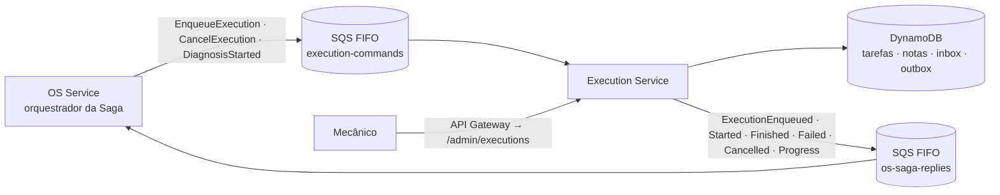

# Oficina — Execution Service

Microsserviço de **execução e produção** da oficina (Tech Challenge FIAP, Fase 4). Gerencia a fila de execução das
ordens de serviço, acompanha o diagnóstico e o reparo e comunica a finalização (ou a falha) ao **OS Service**, que
orquestra a Saga.

| | |
|---|---|
| Especificação | [`specs/fase4/06-execution-service.md`](https://github.com/victor-duarte-mendonca/oficina-app/blob/homolog/specs/fase4/06-execution-service.md) (no `oficina-app`) |
| Banco | **DynamoDB** (NoSQL), tabela única — o banco não relacional exigido pelo desafio |
| Mensageria | SQS FIFO: consome `execution-commands`, publica em `os-saga-replies` |
| Stack | Java 21, Quarkus 3.15.7, AWS SDK v2, hexagonal |
| Outros repositórios | [`oficina-app`](https://github.com/victor-duarte-mendonca/oficina-app) (OS + Saga), `oficina-billing-service` (orçamento e pagamento), [`oficina-infra-k8s`](https://github.com/victor-duarte-mendonca/oficina-infra-k8s), [`oficina-infra-database`](https://github.com/victor-duarte-mendonca/oficina-infra-database), [`oficina-auth-lambda`](https://github.com/victor-duarte-mendonca/oficina-auth-lambda) |

## O que o serviço faz (e o que não faz)

- **Faz:** fila de reparo ordenada por prioridade e antiguidade; tarefa de diagnóstico para o mecânico registrar o que
  encontrou; início, notas técnicas, conclusão e falha do trabalho; respostas à Saga.
- **Não faz:** preço, orçamento ou pagamento (Billing); cadastro de cliente, veículo ou OS (OS Service). Não lê o banco
  de nenhum outro serviço: o veículo e os itens chegam no comando da Saga.



## Papel na Saga

| Comando recebido | Resposta | Observação |
|---|---|---|
| `EnqueueExecution` (pagamento confirmado) | `ExecutionEnqueued{position}` ou `ExecutionEnqueueFailed{reason}` | a recusa (ex.: reparo já concluído) faz a Saga **estornar** o cliente |
| `CancelExecution` (compensação) | `ExecutionCancelled{alreadyFinished}` | idempotente: OS sem reparo ou já cancelado também confirma |
| `DiagnosisStarted` (informativo) | — | abre a tarefa de diagnóstico |
| mecânico inicia / conclui / falha | `ExecutionStarted` / `ExecutionFinished` / `ExecutionFailed` | a falha dispara estorno + cancelamento da OS |
| nota técnica | `ExecutionProgress` (`INFO`) | vai para o histórico da OS, não move a Saga |

Contratos: [`contracts/`](contracts/) — este serviço é o dono de `execution-events.schema.json`; os demais são cópias.

## Banco: por que DynamoDB

O acesso é sempre por chave (a tarefa de uma OS) ou por uma fila ordenada — não há junções nem relatórios ad hoc.
O DynamoDB on-demand não tem custo ocioso nem ocupa memória no nó único do k3s, e a escrita transacional
(`TransactWriteItems`) dá a atomicidade de que a Saga precisa. Seria pior se surgissem relatórios analíticos
sobre a execução (aí um banco relacional ou uma réplica analítica).

| Item | PK | SK | Índice |
|---|---|---|---|
| Tarefa | `WO#<id>` | `TASK#<fase>` | GSI1 `QUEUE#<fase>#<status>` / `prioridade#entrada#os` |
| Nota técnica | `WO#<id>` | `NOTE#<fase>#<instante>#<id>` | — |
| Inbox (deduplicação) | `MSG#<messageId>` | `INBOX` | — (TTL 7 dias) |
| Outbox | `OUT#<messageId>` | `OUTBOX` | GSI2 esparso `PENDING` / `criação#id` |

**Consistência:** cada comando ou ação do mecânico grava tarefa, notas, outbox e inbox numa única transação,
com trava otimista pela versão da tarefa. Mensagem repetida é absorvida pelo inbox; conflito de versão devolve a
mensagem à fila para reprocessamento; mensagem malformada vai para a DLQ depois das reentregas.

## API (via API Gateway, papéis `ADMIN` e `MECHANIC`)

| Método | Rota | Função |
|---|---|---|
| `GET` | `/admin/executions?phase=REPAIR&status=QUEUED&limit=20` | fila ordenada |
| `GET` | `/admin/executions/{workOrderId}` | tarefas das duas fases e notas |
| `POST` | `/admin/executions/{workOrderId}/start?phase=REPAIR` | inicia (responsável = usuário do token) |
| `POST` | `/admin/executions/{workOrderId}/notes?phase=REPAIR` | `{text, kind}` |
| `POST` | `/admin/executions/{workOrderId}/finish?phase=REPAIR` | `{summary}` |
| `POST` | `/admin/executions/{workOrderId}/fail` | `{reason}` — só no reparo |

OpenAPI em `/q/openapi` (Swagger UI em `/q/swagger-ui` fora de produção). Erros: 401 sem token, 403 com papel errado
ou sem o `X-Gateway-Key` do gateway, 404 OS sem tarefa, 409 alteração concorrente, 422 transição inválida.

## Arquitetura interna (hexagonal)

```
domain/          ExecutionTask (agregado), Phase, TaskStatus, VehicleInfo, WorkItem, TechnicalNote, ExecutionEvent
application/     ExecutionCommandHandler + strategies por comando (Enqueue, Cancel, DiagnosisStarted),
                 ExecutionWorkService (mecânico), TaskEvents, ExecutionMessageFactory, portas in/out
infrastructure/  DynamoDB (repositório + unit of work transacional + outbox), SQS, relay, consumidor, métricas
interfaces/      REST (/admin/executions), filtros de correlação e de gateway, mapeamento de erros
```

Padrões: **Strategy** (um tratador por comando), **Unit of Work** (gravação atômica de estado + outbox + inbox),
**Transactional Outbox** e **Idempotent Consumer**, eventos registrados pelo agregado.

## Como rodar localmente

```bash
docker compose up --build
```

Sobe o LocalStack (DynamoDB + SQS, com as filas criadas por `scripts/localstack-init.sh`) e o serviço em
`http://localhost:8082`. A chave pública montada é a **de teste** (`src/test/resources/test-keys`), só para dev.

## Testes, cobertura e qualidade

```bash
mvn verify   # exige Docker (LocalStack via Testcontainers)
```

| Tipo | Onde |
|---|---|
| Unidade do domínio | `ExecutionTaskTest` — transições, idempotência, eventos |
| Casos de uso | `ExecutionApplicationTest` — sobre armazenamento em memória com as mesmas garantias do DynamoDB |
| Contrato | `ExecutionContractTest` — eventos publicados validam no schema; comandos de exemplo do OS são tratados |
| Integração (LocalStack) | `ExecutionFlowIntegrationTest` — fila → tarefa → outbox → resposta; inbox; trava otimista |
| API | `ExecutionResourceTest` — ciclo pelo mecânico, 401/403/404/422, correlação |

O `mvn verify` reprova abaixo de **80% de linhas e 70% de ramos** do serviço (e 80% nos pacotes de domínio e aplicação).
Última medição local (2026-11-23): **66 testes, 97,3% de linhas, 84,9% de ramos**. Relatório: `target/site/jacoco/index.html`.

## CI/CD

`.github/workflows/ci.yml`: `build-test` (testes + gate), `docker-build` (imagem + Trivy) e `workflow-lint`
(actionlint + kustomize). Análise SonarCloud: spec 10.

`.github/workflows/deploy.yml` (independente dos outros serviços; `homolog` → `hml`/`homologacao`, `main` → `prod`/`producao`
com aprovação manual):

```
image   consulta /oficina/<env>/ecr_execution_url no SSM → build → Trivy (CRITICAL corrigível) → push (tag = SHA)
deploy  túnel SSM ao k3s → Secret (tabela e filas lidas do SSM) → kubectl apply -k → rollout status
        → smoke test (scripts/smoke-test.sh) → rollback automático se falhar
```

- **Sob demanda**: sem stack ou sem sessão AWS, o push passa verde com um aviso; o disparo manual (*Run workflow*) trata a falta como erro. O deploy não executa Terraform.
- **Pré-requisitos**: o `oficina-app` já publicado no ambiente (namespace e chave pública do JWT); parâmetros SSM `ecr_execution_url`, `execution/dynamodb_table`, `sqs/execution_commands_url`, `sqs/os_replies_url`.
- **Environment** (`homologacao`/`producao`): secret `APP_GATEWAY_KEY` (obrigatório em prod). Os `AWS_*` são da organização e expiram com a sessão do Academy.
- **Credenciais da AWS no pod**: vêm do IMDS da EC2 (LabRole, ADR 0022); nenhuma chave entra no Secret.
- **Rollback**: `kubectl rollout undo` se o rollout ou o smoke test falharem; o rollback de um serviço não afeta os outros.
- **Ordem numa mudança de contrato**: consumidor primeiro, produtor depois; remoção só numa versão posterior.
- **Reproduzir localmente**: `mvn verify` (testes + gate JaCoCo), `docker build .`, `shellcheck scripts/*.sh`, `kubectl kustomize k8s/overlays/hml`.

## Segurança

- Valida o mesmo JWT RS256 do OS e do Lambda; o pod monta **só a chave pública**.
- `X-Gateway-Key` obrigatório em `/admin/*` (acesso direto ao nó é recusado).
- Credenciais AWS pela cadeia padrão do SDK (IMDS do nó no k3s, ADR 0022); nenhuma chave no repositório.
- Pod sem root, sistema de arquivos somente leitura, sem token de ServiceAccount, NetworkPolicy de menor privilégio.

## Limitações conhecidas

- O `LabRole` do AWS Academy é único: não há IAM por serviço (ver ADR 0022 no `oficina-app`).
- Duas réplicas podem publicar a mesma mensagem do outbox ao mesmo tempo; a deduplicação do SQS FIFO (mesmo
  `messageId`, janela de 5 min) evita a cópia.
